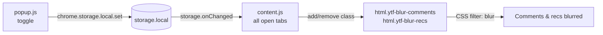

<div align="center">
  

  <h1>YTFocus</h1>
  <p><strong>YouTube, without distractions.</strong></p>

  <p>
    <a href="./README.md">🇬🇧 English</a> ·
    <a href="./READMEID.md">🇮🇩 Bahasa Indonesia</a>
  </p>
</div>

<div align="center">

[](./LICENSE)
[](./manifest.json)
[](./content.js)
[](#)
[](./manifest.json)

</div>

---

A browser extension that blurs out YouTube's two biggest attention traps — the **comment section** and the **recommendation rail** — so the video becomes the only thing on screen. No accounts, no tracking, no build step.

**Repository:** [`malvinjauhari/YT-Focus`](https://github.com/malvinjauhari/YT-Focus)

---

## Table of Contents

- [The Problem](#the-problem)
- [Features](#features)
- [Installation](#installation)
- [How It Works](#how-it-works)
- [Project Structure](#project-structure)
- [Permissions, Explained](#permissions-explained)
- [Privacy](#privacy)
- [Settings Reference](#settings-reference)
- [Development](#development)
- [Troubleshooting](#troubleshooting)
- [Contributing](#contributing)
- [License](#license)
- [Author](#author)

---

## The Problem

YouTube is engineered to keep you watching. The comment section rewards outrage, the recommendation rail is an infinite slot machine that autoplays whatever comes next, and the end screen ambushes you with four more thumbnails before the video finishes.

The usual fixes — blockers, subscriptions-only feeds, reinstalling the app every few weeks — all cost you the thing you opened YouTube for.

YTFocus takes a narrower approach: **remove the trigger surface, keep the video.** Everything else about the page, the player, the search, your subscriptions, your history stays exactly as it was.

## Features

| | |
|---|---|
| **Blur comments** | The entire comment section, including the composer, is blurred out of reach. |
| **Blur recommendations** | The sidebar rail and the end-screen cards stop competing for your attention. |
| **Instant, everywhere** | Flip a toggle in the popup and every open YouTube tab updates immediately — no refresh. |
| **GPU-composited** | Blur runs on the graphics layer via `translateZ(0)` + `will-change`, so scrolling stays smooth. |
| **SPA-aware** | YouTube replaces its entire DOM on navigation; YTFocus survives it without a reload. |
| **Zero network calls** | No telemetry, no analytics, no remote config. The extension never phones home. |
| **Three permissions** | `storage`, `activeTab`, `scripting` — and host access scoped strictly to YouTube. |
| **No build step** | Plain HTML, CSS, and JavaScript. Clone, load unpacked, done. |

## Installation

YTFocus is loaded as an unpacked extension — there is no build step and no `node_modules`.

**Requirements:** Chrome, Edge, or Brave **88+** (or any Chromium browser with Manifest V3 support).

```bash
git clone https://github.com/malvinjauhari/YT-Focus.git
```

Then:

1. Open `chrome://extensions` in your browser.
2. Turn on **Developer mode** (top-right toggle).
3. Click **Load unpacked**.
4. Select the cloned folder (`YT-Focus`).
5. **Reload** any YouTube tab that's already open.

That's it. Pin YTFocus to your toolbar, click the icon, and flip the toggles.

> **Note:** Loading unpacked requires Developer mode to stay enabled. If you plan to use YTFocus daily, [open an issue](https://github.com/malvinjauhari/YT-Focus/issues) asking for a Web Store release — that would remove this requirement.

## How It Works

The whole extension is four files and about 300 lines. The design principle is **one style injection, then only class toggles** — no re-rendering, no re-querying the DOM, no work during playback.



### 1. Injection happens as early as possible

`content.js` is registered in `manifest.json` with `"run_at": "document_start"`, so it runs before YouTube paints. It injects a single `<style>` element (id `ytfocus-styles`) carrying every visual rule.

### 2. Toggling is a class mutation, not a restyle

All CSS is gated behind two classes on the root element:

```css
html.ytf-blur-comments ytd-comments { filter: blur(12px) opacity(0.7) !important; }
html.ytf-blur-recs ytd-watch-next-secondary-results-renderer { /* ... */ }
```

Flipping a toggle adds or removes one class. The browser does the rest — no JavaScript touches the comment nodes themselves.

### 3. Settings are shared, and storage is the source of truth

The popup writes two booleans to `chrome.storage.local`. Every open tab listens on `chrome.storage.onChanged` and applies them, so a change made in one window appears in all of them at once. Tabs are also sent a direct `YTFOCUS_UPDATE` message as a fast path.

### 4. YouTube's SPA can't shake it loose

YouTube re-renders aggressively on navigation and routinely rewrites its own root classes. A `MutationObserver` watches **only** the `class` attribute of `<html>` and re-asserts YTFocus's classes if they were stripped:

```js
observer.observe(document.documentElement, {
  attributes: true,
  attributeFilter: ['class']   // nothing else is observed — zero cost during playback
});
```

### 5. No refresh required, ever

When the popup opens, it `PING`s the active tab. If no content script answers — because the tab was opened before YTFocus was installed — the popup injects `content.js` on the spot via `chrome.scripting.executeScript`. A `window.__YTFOCUS_INJECTED__` guard makes any double-injection a no-op.

## Project Structure

```
YT-Focus/
├── manifest.json          # Manifest V3: permissions, content script registration, icons
├── content.js             # Runs in every YouTube tab — injects CSS, toggles classes, syncs settings
├── popup.html             # Toolbar popup markup (two toggles)
├── popup.css              # Popup styling, including the switch component
├── popup.js               # Reads/writes settings, injects content script if missing
├── icons/                 # icon16 / icon48 / icon128
├── LICENSE                # MIT
├── CONTRIBUTING.md        # How to contribute
├── README.md              # This file (English)
└── READMEID.md            # Dokumentasi Bahasa Indonesia
```

| File | Responsibility |
|---|---|
| `manifest.json` | Declares permissions, host access, icons, and registers `content.js` at `document_start`. |
| `content.js` | Injects the stylesheet, applies settings to `<html>` classes, listens for storage changes, survives SPA navigation. |
| `popup.html` / `popup.css` | The two-switch popup UI. |
| `popup.js` | Binds switches to `chrome.storage.local`, guarantees the content script is live in the current tab. |

## Permissions, Explained

Extension permissions deserve scrutiny, so here's every one of them and exactly why it exists.

| Permission | Why YTFocus needs it |
|---|---|
| `storage` | Persist your two toggle settings locally. Nothing leaves the device. |
| `activeTab` | Read the URL of the tab you clicked the popup on, to confirm it's a YouTube tab. |
| `scripting` | Inject `content.js` into a tab that was already open when YTFocus was installed. |
| `*://*.youtube.com/*` | Host access to YouTube only. Required to run the content script and apply the blur. |

There is no `tabs` permission, no `<all_urls>`, and no access to any site other than YouTube.

## Privacy

- **No tracking.** No analytics, no telemetry, no usage reporting, no fingerprinting.
- **No network requests.** YTFocus has no server and never sends anything anywhere. You can verify this in `chrome://extensions` → *Inspect views → service worker*, or by disconnecting from the network entirely — it keeps working.
- **No remote code.** The Manifest V3 policy prohibits it, and YTFocus ships none.
- **Local-only data.** Your settings live in `chrome.storage.local` for this browser profile. Clearing extension data resets them.

## Settings Reference

Stored in `chrome.storage.local` under these keys. Both default to `true`, so YTFocus is active as soon as you install it.

| Key | Type | Default | Effect |
|---|---|---|---|
| `hideComments` | `boolean` | `true` | Blurs `ytd-comments` and `#comments`. |
| `blurRecommendations` | `boolean` | `true` | Blurs the sidebar rail and `.ytp-endscreen-content` / `.ytp-ce-video` cards. |

## Development

There's no package manager, bundler, or framework. The source you read is the source the browser runs.

```bash
git clone https://github.com/malvinjauhari/YT-Focus.git
cd YT-Focus
```

Your edit-refresh loop:

1. Make your change in `content.js` or `popup.js`.
2. Hit `chrome://extensions` → **Reload** on YTFocus.
3. **Refresh** your YouTube tab (`Ctrl`/`Cmd` + `Shift` + `R` for a hard refresh).
4. Verify, then open a PR.

See [CONTRIBUTING.md](./CONTRIBUTING.md) for commit conventions, PR process, and a recipe for adding new blur targets.

## Troubleshooting

**Nothing looks blurred.**
Make sure the toggle in the popup is on. If you just installed YTFocus, hard-refresh the YouTube tab — tabs open before installation run the old page. If it still doesn't work, open DevTools → Console and check that the `<html>` element carries `ytf-blur-comments`.

**The blur disappeared after navigating.**
YouTube sometimes rewrites its root classes. YTFocus's `MutationObserver` normally repairs this within a frame — if a specific page still fails, [open an issue](https://github.com/malvinjauhari/YT-Focus/issues) with the page URL.

**The comments are still clickable / selectable.**
They shouldn't be — the CSS sets `pointer-events: none` and `user-select: none`. If a selector stopped matching, it's a YouTube redesign. Contributions to fix that are very welcome.

**The popup does nothing on a YouTube tab.**
Check that Developer mode is still enabled and that YTFocus isn't paused in `chrome://extensions`.

## Contributing

Contributions are genuinely welcome — especially new blur targets when YouTube redesigns. See **[CONTRIBUTING.md](./CONTRIBUTING.md)** for the full guide, and use the issue tracker for anything you'd like to discuss first.

## License

Released under the **[MIT License](./LICENSE)**.

```
Copyright (c) 2026 Alvin Jauhari
```

## Author

**Alvin Jauhari** — [@malvinjauhari](https://github.com/malvinjauhari)

---

<div align="center">
  <sub>Made for people who open YouTube to watch one video.</sub>
</div>
