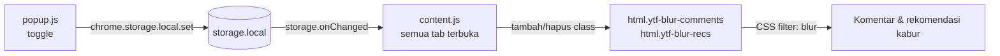

<div align="center">
  

  <h1>YTFocus</h1>
  <p><strong>YouTube, tanpa distraksi.</strong></p>

  <p>
    <a href="./README.md">🇬🇧 English</a> ·
    <a href="./READMEID.md">🇮🇩 Bahasa Indonesia</a>
  </p>
</div>

<div align="center">

[](./LICENSE)
[](./manifest.json)
[](./content.js)
[](#)
[](./manifest.json)

</div>

---

Ekstensi browser yang membuat dua jebakan perhatian terbesar YouTube — **kolom komentar** dan **rel rekomendasi** — menjadi kabur, sehingga videonya jadi satu-satunya hal di layar. Tanpa akun, tanpa pelacakan, tanpa proses build.

**Repositori:** [`malvinjauhari/No-More-Distract`](https://github.com/malvinjauhari/No-More-Distract)

---

## Daftar Isi

- [Masalahnya](#masalahnya)
- [Fitur](#fitur)
- [Instalasi](#instalasi)
- [Cara Kerja](#cara-kerja)
- [Struktur Proyek](#struktur-proyek)
- [Penjelasan Izin Akses](#penjelasan-izin-akses)
- [Privasi](#privasi)
- [Referensi Pengaturan](#referensi-pengaturan)
- [Pengembangan](#pengembangan)
- [Mengatasi Masalah](#mengatasi-masalah)
- [Berkontribusi](#berkontribusi)
- [Lisensi](#lisensi)
- [Penulis](#penulis)

---

## Masalahnya

YouTube dirancang agar Anda terus menonton. Kolom komentar dirancang untuk memancing amarah, rel rekomendasi adalah mesin slot tanpa akhir yang memutar video berikutnya secara otomatis, dan layar akhir menyergap dengan empat thumbnail lain sebelum video selesai.

Solusi yang biasanya orang pakai — blocker, feed langganan saja, atau memasang ulang aplikasi setiap beberapa minggu — semuanya mengorbankan hal yang justru membuat Anda membuka YouTube.

YTFocus mengambil pendekatan yang lebih sempit: **hilangkan pemicunya, pertahankan videonya.** Semua hal lain tentang halaman, pemutar video, pencarian, langganan, dan riwayat Anda tetap persis seperti sebelumnya.

## Fitur

| | |
|---|---|
| **Blur komentar** | Seluruh kolom komentar, termasuk kotakulis, dibuat kabur dan tidak bisa diklik. |
| **Blur rekomendasi** | Rel di sisi dan kartu layar akhir berhenti bersaing memperebutkan perhatian. |
| **Instan, di semua tab** | Ubah pengaturan di popup, semua tab YouTube yang terbuka langsung ikut berubah — tanpa refresh. |
| **Dituang oleh GPU** | Efek blur berjalan di lapisan grafis lewat `translateZ(0)` + `will-change`, sehingga scroll tetap halus. |
| **Siap untuk SPA** | YouTube mengganti seluruh DOM-nya saat navigasi; YTFocus tetap bertahan tanpa reload. |
| **Tanpa koneksi jaringan** | Tidak ada telemetri, analitik, atau konfigurasi jarak jauh. Ekstensi tidak pernah menghubungi server. |
| **Tiga izin akses** | `storage`, `activeTab`, `scripting` — dan akses host dibatasi hanya ke YouTube. |
| **Tanpa build step** | HTML, CSS, dan JavaScript biasa. Clone, load unpacked, selesai. |

## Instalasi

YTFocus dimuat sebagai ekstensi *unpacked* — tidak ada proses build dan tidak ada `node_modules`.

**Kebutuhan:** Chrome, Edge, atau Brave **88+** (atau browser berbasis Chromium lain yang mendukung Manifest V3).

```bash
git clone https://github.com/malvinjauhari/No-More-Distract.git
```

Kemudian:

1. Buka `chrome://extensions` di browser Anda.
2. Aktifkan **Mode Pengembang** (toggle di kanan atas).
3. Klik **Load unpacked**.
4. Pilih folder hasil clone (`No-More-Distract`).
5. **Muat ulang** tab YouTube yang sudah terbuka.

Selesai. Pasang YTFocus di toolbar, klik ikonnya, lalu atur sesuai kebutuhan.

> **Catatan:** Mode Pengembang harus tetap aktif selama ekstensi dimuat secara *unpacked*. Kalau Anda memang memakai YTFocus setiap hari, sampaikan di [Discussions](https://github.com/malvinjauhari/No-More-Distract/discussions) — rilis ke Chrome Web Store akan menghilangkan syarat ini.

## Cara Kerja

Seluruh ekstensi ini hanya empat file dan sekitar 300 baris. Prinsip desainnya adalah **satu kali injeksi style, selanjutnya hanya menyalakan class** — tanpa render ulang, tanpa mencari ulang DOM, tanpa kerja saat video diputar.



### 1. Injeksi berlangsung sedini mungkin

`content.js` didaftarkan di `manifest.json` dengan `"run_at": "document_start"`, sehingga berjalan sebelum YouTube selesai menggambar halaman. Script ini menyuntikkan satu elemen `<style>` (id `ytfocus-styles`) yang memuat seluruh aturan visual.

### 2. Mengubah pengaturan hanya mutasi class

Semua CSS dikunci di balik dua class pada elemen root:

```css
html.ytf-blur-comments ytd-comments { filter: blur(12px) opacity(0.7) !important; }
html.ytf-blur-recs ytd-watch-next-secondary-results-renderer { /* ... */ }
```

Mengubah toggle hanya menambah atau menghapus satu class. Browser yang mengerjakan sisanya — tidak ada JavaScript yang menyentuh node komentar secara langsung.

### 3. Pengaturan dibagikan, dan storage adalah sumber kebenaran

Popup menulis dua nilai boolean ke `chrome.storage.local`. Setiap tab yang terbuka mendengarkan `chrome.storage.onChanged` dan langsung menerapkannya, jadi perubahan di satu jendela muncul di semua jendela sekaligus. Setiap tab juga menerima pesan `YTFOCUS_UPDATE` langsung sebagai jalur cepat.

### 4. SPA YouTube tidak bisa melontarkannya

YouTube sering merender ulang saat navigasi dan rutin menulis ulang class pada elemen root-nya. `MutationObserver` hanya mengamati atribut `class` pada `<html>` lalu menegaskan kembali class YTFocus bila dihapus:

```js
observer.observe(document.documentElement, {
  attributes: true,
  attributeFilter: ['class']   // tidak ada yang lain dipantau — nol biaya saat playback
});
```

### 5. Tidak perlu refresh, selamanya

Saat popup dibuka, ia mengirim `PING` ke tab aktif. Jika tidak ada content script yang menjawab — misalnya tab dibuka sebelum YTFocus terpasang — popup langsung menyuntikkan `content.js` dengan `chrome.scripting.executeScript`. Guard `window.__YTFOCUS_INJECTED__` membuat injeksi ganda menjadi tidak berbahaya bagi halaman.

## Struktur Proyek

```
No-More-Distract/
├── manifest.json          # Manifest V3: izin akses, registrasi content script, ikon
├── content.js             # Berjalan di setiap tab YouTube — menyuntikkan CSS, menyalakan class, menyinkronkan pengaturan
├── popup.html             # Markup popup toolbar (dua toggle)
├── popup.css              # Gaya popup, termasuk komponen switch
├── popup.js               # Membaca/menulis pengaturan, menyuntikkan content script bila belum ada
├── icons/                 # icon16 / icon48 / icon128
├── LICENSE                # MIT
├── CONTRIBUTING.md        # Panduan kontribusi
├── README.md              # Dokumentasi Bahasa Inggris
└── READMEID.md            # Dokumen ini
```

| File | Tanggung jawab |
|---|---|
| `manifest.json` | Mendeklarasikan izin akses, host, ikon, dan mendaftarkan `content.js` pada `document_start`. |
| `content.js` | Menyuntikkan stylesheet, menerapkan pengaturan sebagai class pada `<html>`, mendengarkan perubahan storage, bertahan terhadap navigasi SPA. |
| `popup.html` / `popup.css` | Antarmuka popup dengan dua switch. |
| `popup.js` | Mengikat switch ke `chrome.storage.local` dan memastikan content script aktif di tab saat ini. |

## Penjelasan Izin Akses

Izin akses ekstensi layak diperiksa dengan saksama, jadi berikut seluruh izin yang dipakai beserta alasannya.

| Izin | Alasan YTFocus membutuhkannya |
|---|---|
| `storage` | Menyimpan dua pengaturan toggle secara lokal. Tidak ada data yang keluar dari perangkat. |
| `activeTab` | Membaca URL tab tempat Anda mengeklik popup, untuk memastikan tab tersebut YouTube. |
| `scripting` | Menyuntikkan `content.js` ke tab yang sudah terbuka ketika YTFocus baru dipasang. |
| `*://*.youtube.com/*` | Akses host hanya ke YouTube. Diperlukan agar content script dapat berjalan dan blur diterapkan. |

Tidak ada izin `tabs`, tidak ada `<all_urls>`, dan tidak ada akses ke situs mana pun selain YouTube.

## Privasi

- **Tanpa pelacakan.** Tidak ada analitik, telemetri, pelaporan penggunaan, maupun fingerprinting.
- **Tanpa permintaan jaringan.** YTFocus tidak punya server dan tidak pernah mengirim apa pun ke mana pun. Anda bisa memeriksanya di `chrome://extensions` → *Inspect views → service worker*, atau dengan memutus koneksi internet sepenuhnya — YTFocus tetap berfungsi.
- **Tanpa kode jarak jauh.** Kebijakan Manifest V3 melarangnya, dan YTFocus memang tidak menyertakan.
- **Data hanya lokal.** Pengaturan Anda tersimpan di `chrome.storage.local` pada profil browser ini. Menghapus data ekstensi akan mengembalikannya ke default.

## Referensi Pengaturan

Tersimpan di `chrome.storage.local` dengan kunci berikut. Keduanya bernilai `true` secara default, jadi YTFocus langsung aktif begitu dipasang.

| Kunci | Tipe | Default | Efek |
|---|---|---|---|
| `hideComments` | `boolean` | `true` | Membuat `ytd-comments` dan `#comments` kabur. |
| `blurRecommendations` | `boolean` | `true` | Membuat rel samping serta `.ytp-endscreen-content` / `.ytp-ce-video` kabur. |

## Pengembangan

Tidak ada package manager, bundler, maupun framework. Kode yang Anda baca adalah kode yang langsung dijalankan browser.

```bash
git clone https://github.com/malvinjauhari/No-More-Distract.git
cd No-More-Distract
```

Siklus edit–refresh Anda:

1. Ubah `content.js` atau `popup.js`.
2. Buka `chrome://extensions` → **Reload** pada YTFocus.
3. **Refresh** tab YouTube Anda (`Ctrl`/`Cmd` + `Shift` + `R` untuk hard refresh).
4. Pastikan berjalan, lalu buka PR.

Lihat [CONTRIBUTING.md](./CONTRIBUTING.md) untuk konvensi commit, alur PR, dan panduan menambahkan target blur baru.

## Mengatasi Masalah

**Tidak ada yang terlihat kabur.**
Pastikan toggle di popup dalam keadaan aktif. Jika baru memasang YTFocus, lakukan hard refresh pada tab YouTube — tab yang dibuka sebelum pemasangan masih berjalan dengan halaman lama. Jika masih tidak jalan, buka DevTools → Console dan pastikan elemen `<html>` memiliki class `ytf-blur-comments`.

**Efek blur hilang setelah navigasi.**
YouTube kadang menulis ulang class pada elemen root. `MutationObserver` YTFocus biasanya memperbaikinya dalam satu frame — jika halaman tertentu masih gagal, [buka issue](https://github.com/malvinjauhari/No-More-Distract/issues) dengan URL halaman tersebut.

**Komentar masih bisa diklik / diseleksi.**
Seharusnya tidak — CSS menetapkan `pointer-events: none` dan `user-select: none`. Jika suatu selector tidak lagi cocok, kemungkinan besar YouTube telah merombak desainnya. Kontribusi untuk memperbaikinya sangat diterima.

**Popup tidak bereaksi di tab YouTube.**
Pastikan Mode Pengembang masih aktif dan YTFocus tidak dalam keadaan *paused* di `chrome://extensions`.

## Berkontribusi

Kontribusi sangat diterima — terutama target blur baru saat YouTube merombak desainnya. Lihat **[CONTRIBUTING.md](./CONTRIBUTING.md)** untuk panduan lengkap, dan gunakan issue tracker untuk hal yang ingin didiskusikan lebih dulu.

## Lisensi

Dirilis di bawah **[Lisensi MIT](./LICENSE)**.

```
Copyright (c) 2026 Alvin Jauhari
```

## Penulis

**Alvin Jauhari** — [@malvinjauhari](https://github.com/malvinjauhari)

---

<div align="center">
  <sub>Dibuat untuk orang yang membuka YouTube hanya untuk menonton satu video.</sub>
</div>
